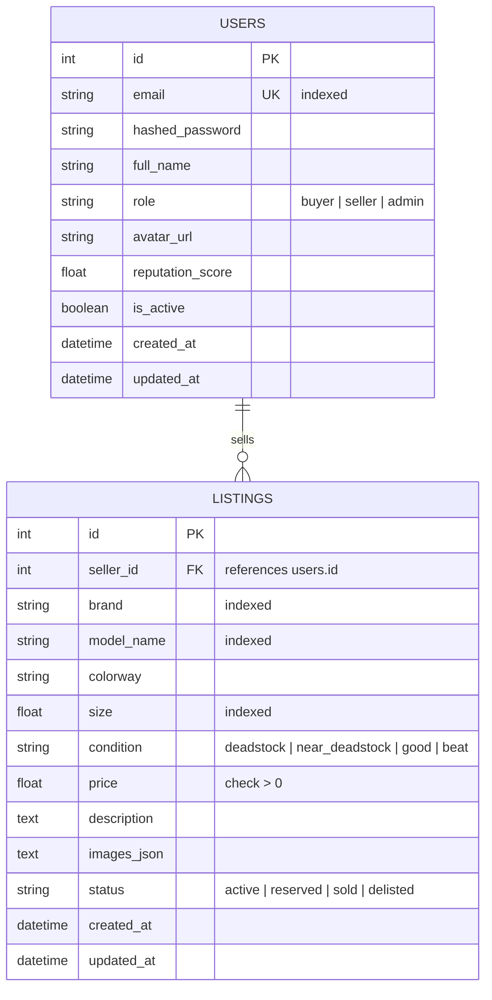

# ADR-003: Core Database Schema Design (MVP)

**Status:** Accepted  
**Date:** October 2026  
**Deciders:** Lead Software Engineer & Quality Engineer  

---

## 1. Context & Problem Statement

To build our marketplace MVP, we need a data persistence layer that supports:
1. User identity and authentication (passwords, profiles, roles).
2. Shoe listings posted by sellers (brand, model, size, condition, price, image URLs).
3. Relational integrity (a listing must always reference a valid seller).
4. Frictionless local development and test automation without requiring external cloud databases running during test runs.

---

## 2. Considered Alternatives

### 2.1 Storage Paradigm: Relational (SQL) vs Document (NoSQL)
- **Document (MongoDB / DynamoDB):** Flexible schema, but lacks strict relational foreign keys and relational constraints. In marketplaces, orphaned records or missing relations create catastrophic data inconsistencies.
- **Relational SQL (PostgreSQL / SQLite) [Selected]:** Strict schema enforcement, ACID guarantees, foreign key cascades, and mathematical relation modeling.

### 2.2 Database Engine Portability: SQLite vs PostgreSQL
- **Decision:** Use **SQLAlchemy 2.0 Async ORM** to achieve dual-engine portability:
  - **Local Development & Fast CI Testing:** `sqlite+aiosqlite:///./solemarket.db` (zero external dependencies, sub-millisecond in-memory test execution).
  - **Docker / Staging / Production:** `postgresql+asyncpg://...` (high concurrency, robust connection pooling).

---

## 3. Decision: MVP Entities & Schema

For the initial MVP, we deliberately keep the schema minimal and focused on two core entities:

### Key Field Design Decisions:
1. **User Identity:**
   - `email` is strictly unique and lowercased to prevent duplicate accounts (`user@test.com` vs `USER@test.com`).
   - `hashed_password` stores a salted Bcrypt hash. Never plaintext.
   - `is_active` boolean allows soft-banning or account deactivation without breaking relational order history.
2. **Shoe Listings:**
   - `seller_id` enforces foreign key constraint to `users(id)` with `ON DELETE CASCADE`.
   - `price` has a database check constraint (`price > 0`).
   - `condition` is restricted to explicit enum values.
   - `status` defaults to `active`.
3. **Auditability:**
   - Both tables inherit a `TimestampMixin` providing automatic UTC `created_at` and `updated_at`.

---

## 4. What Is Deliberately Deferred (Future ADRs)
To keep the MVP lean and avoid premature complexity:
- **Orders & Payment Transactions:** Deferred to future ADR (Orders & Concurrency Locking).
- **Search Vector Embeddings:** Deferred to future ADR (AI Multimodal & Semantic Search).
- **Redis Query Caching:** Deferred to future ADR (Caching & Performance Optimization).
