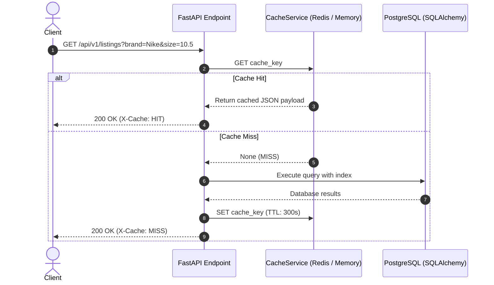

# ADR-005: Multi-Tier Caching & Invalidation Strategy

**Status:** Accepted  
**Date:** October 2026  
**Deciders:** Lead Software Engineer & Quality Engineer  

---

## 1. Context & Problem Statement

Marketplace browse and search traffic is read-heavy (90% reads vs 10% writes). Querying the relational database on every listing search or home page view produces high CPU utilization, slows response times, and increases database connection pool pressure.

We require a caching strategy that:
1. Keeps p99 search latency under 50ms for frequent queries.
2. Implements a clear invalidation policy so buyers never see stale sold items as available.
3. Provides an in-memory fallback for local development or when Redis is unavailable.

---

## 2. Decision: Cache-Aside with Event-Driven Invalidation

### 2.1 Cache Key Strategy

Keys are namespaced and hashed for deterministic lookup:
- Catalog Search: `cache:listings:search:{hash(params)}` (TTL: 300 seconds / 5 minutes)
- Single Listing Detail: `cache:listing:{listing_id}` (TTL: 600 seconds / 10 minutes)
- Popular Shoes: `cache:shoes:popular` (TTL: 1800 seconds / 30 minutes)

### 2.2 Invalidation Strategy

Stale data in e-commerce leads to failed checkouts. Therefore, cache invalidation is explicitly triggered on write events:
- When a new listing is created: Invalidate `cache:listings:search:*` patterns.
- When a listing is updated or purchased: Invalidate `cache:listing:{listing_id}` and `cache:listings:search:*`.

### 2.3 Abstract Adapter Pattern

To allow seamless zero-dependency local testing without mandating a running Redis instance, the backend defines an abstract `CacheService` interface:
- `RedisCacheService`: Uses `redis-py` async pool when `REDIS_URL` is configured.
- `InMemoryCacheService`: Uses an LRU async in-memory dictionary with TTL expiration for local development and unit/integration testing.
