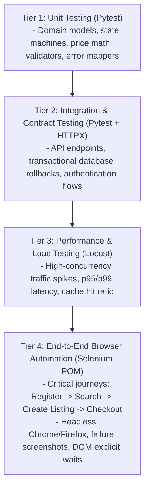

# ADR-007: Quality Assurance & Testing Pyramid Strategy

**Status:** Accepted  
**Date:** October 2026  
**Deciders:** Lead Software Engineer & Quality Engineer  

---

## 1. Context & Problem Statement

Quality Assurance Engineering (QAT/SDET) requires a structured, multi-layered approach to ensure software correctness, performance, and resilience. Over-relying on slow E2E UI tests creates brittle test suites, while relying exclusively on unit tests leaves integration and user journey regressions undetected.

We need a comprehensive Quality Strategy that demonstrates modern QA practices for both SWE and SDET/QAT roles:
1. Fast feedback cycles during development.
2. Complete test coverage across the traditional Test Pyramid.
3. Realistic end-to-end browser automation using Selenium WebDriver with the Page Object Model (POM).
4. Performance and stress testing under high concurrency.

---

## 2. Decision: Multi-Tiered Testing Pyramid

### 2.1 Tier Breakdown & Tooling

| Tier | Tooling | Execution Target | Coverage Target | Purpose |
| :--- | :--- | :--- | :--- | :--- |
| **Unit Tests** | `pytest`, `pytest-mock` | < 2 seconds | > 85% domain logic | Validate pure business logic, invariants, and validation rules in isolation. |
| **Integration Tests** | `pytest-asyncio`, `httpx.AsyncClient` | < 15 seconds | 100% API endpoints | Validate request/response JSON contracts, database constraints, and auth middleware. |
| **E2E Automation** | **Selenium WebDriver (Python)** + `pytest` | < 60 seconds | Top 5 user journeys | Validate real browser rendering, form handling, client-server reactivity, and DOM assertions using POM. |
| **Performance Tests** | **Locust** | On demand / Pre-release | p95 < 100ms at 200 RPS | Stress test listing search endpoints and measure Redis caching efficiency under traffic spikes. |
| **Static Analysis** | `ruff`, `mypy`, `bandit` | Pre-commit / CI | 0 errors | Enforce linting, static typing, and automated security vulnerability checks. |

### 2.2 Selenium Page Object Model (POM) Design

The E2E test suite in `tests-e2e/` abstracts browser interactions into reusable Page Objects:
- `BasePage`: Encapsulates WebDriver instance, explicit WebDriverWait utilities, screenshot captures, and locator helpers.
- `LoginPage`: Login and registration form locators and actions.
- `CatalogPage`: Filter inputs, search bar, shoe card components, and pagination controls.
- `ListingCreatePage`: Multi-step form for creating new shoe listings with image upload simulation.
- `CheckoutPage`: Purchase confirmation, order summary verification, and receipt display.

### 2.3 Quality Gates & CI/CD Pipeline
Every Pull Request must pass the automated GitHub Actions pipeline:
1. Lint & Type Check (`ruff` + `mypy`)
2. Unit & Integration Tests with Coverage Gate (`pytest --cov-fail-under=85`)
3. E2E Headless Browser Run (Chrome headless in Docker / GitHub runner)
4. Docker Container Build Verification
